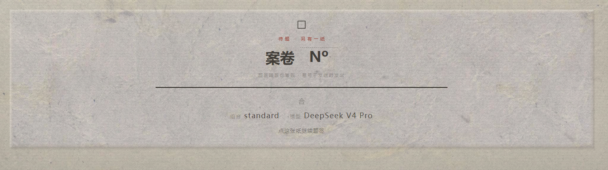

# 多题签（多张待题纸）

> 立项：2026-11-17 · 触发：用户报「画布上有一张题签之后，既不能回头和已有会话交互，也不能同时创建多个题签」。
> 设计件主线（单纸 → 多纸的来由与视觉口径）：[new-session-ux.md](new-session-ux.md)。

## 一句话

纸不再「同一时刻最多一张」，也不再把整个画布锁成「只能跟这张纸说话」：**多张纸并列，
每张各有自己的题签与草稿；焦点独占**——焦点在纸上时坞让位，点任意一卷焦点就交回去、
坞立刻回来，纸留在画布上不动。

## 三个根因（一处一个）

| # | 根因 | 住哪 | 现在 |
|---|---|---|---|
| ① | 纸是**单例**：anchor/picks/notice/morph 各一份 ⇒ 第二张只能是「重定位上一张」 | `state/draft-sheet-store` | `papers[]`（每条：锚点/题签/失败原因）+ `focusedId` + `morphs{}` |
| ② | 纸**窃取面板 live 输入槽**：纸上的输入面与坞共用同一个 input store 实例 ⇒ 坞即便渲染出来，读到的也是纸上的字 | `state/input-store` | 槽键通用化（`s:<sid>` / `draft:<paperId>`）+ `liveOwner` + `claimLive` / `releaseLive`：纸与卷**换手**，不再是两个写者抢一格 |
| ③ | 「纸在场 ⇒ 坞整只不渲染」⇒ 不能跟任何已有会话说话 | `PaperPanel` / `ComposerDock` / `use-paper-panel` | 判据改**焦点在纸上**（`focusedId !== null`）；纸在画布上但不拿焦点时坞照常工作 |

## 语义（四条，改之前先读这一张表）

| 动作 | 焦点 | live 输入归谁 | 坞 | 纸 |
|---|---|---|---|---|
| 点「＋」/ 空态 CTA / 造模式 | 新那张纸 | 它（`draft:<id>`） | 让位 | 新增一张（旧纸不动） |
| 点某张非焦点纸 | 那张 | 它 | 让位 | 它展开输入面，其余收成一行 |
| 点某一卷 / 点画布空白 | null | 该卷（`s:<sid>`） | **回来** | 留在画布上，只显示天头 + 题签一行 |
| 发送（焦点在纸上） | 交回卷 | 交回卷 | 回来 | 化卷（该纸进 `morphs` 退场，其余纸不动） |
| Esc / 纸上的「弃纸」 | null | 该卷 | 回来 | **只弃这一张**（草稿不落槽） |

**换焦点 = 换手 live 槽**：`claimLive` 先按 `liveOwner` 把旧主的字存回它的槽、再把新主的
槽取出来。同一 owner 重复调用是幂等的（不覆盖正在打字的正文）。

## 纸上输入面的「精细编辑」（2026-11-17 第三报：「题签态的输入框没法对文字进行精细编辑」）

三处病灶同住一条根：**纸上的输入面是「世界层里的一件」，而世界里所有的通用判据都是为纸面
正文写的**。正文要的是「不可选的界面 + 朱线选区 + 滚轮=挪镜头」，输入面要的恰好相反。

| # | 病灶 | 根因（一处） | 治法 |
|---|---|---|---|
| ① | 选中一段字**看不见** | `.pp-region ::selection` 是通配选择器（`*`），把纸上 textarea 的选区洗底也洗成透明；而替代方案「手写朱线」只认 `.pp-block` 内的正文选区（`snapshotBlockSelection` 明确排除输入件）⇒ 输入件里的选区**两头落空** | 输入件自证洗底：`.pp-region :where(input, textarea, select, [contenteditable…])::selection`（同具体度、写在后 ⇒ 压过通配那条，正文仍透明） |
| ② | 长草稿**滚不动** | 画布 `wheel` 监听无差别 `preventDefault` + 改 pan；输入件自己的滚动是 UA 默认行为，被吃掉就没得滚。旧豁免只有 `pre / .pp-out`（程文输出区） | 豁免表补**输入件**，尺子用全仓唯一的 `isEditableSurface`（不另写选择器）；Ctrl+wheel 仍归画布（缩放意图明确） |
| ③ | **Shift/Ctrl + ↑↓ 被历史吃掉** | 输入历史的判据只写「首行 + ↑」——扩选（Shift+↑）与跳段（Ctrl+↑）都落进同一条分支，正文被历史里那句整条替换 | 判据入口加 `!selectMod`（Shift/Ctrl/Meta）：词/段选择是编辑，不是历史；不带修饰的 ↑↓ 原样 |

钉子：`paper-visual-decisions`（输入件洗底那条规则与正文透明那条**同时**在册）、
`paper-viewport-ux`（滚轮在 textarea 上原生透传 + Ctrl+wheel 仍缩放）、
`composer-dock-keyboard`（Shift/Ctrl+↑ 不动正文、不带修饰的 ↑ 照旧进历史）。三例都做过
变异检验（摘掉对应判据 ⇒ 该例转红）。

**判据必须看事件源**（2026-11-17 真机 bug，用户："点题签的输入框之后直接跳到无法打字的状态"）：
"点空白 = 焦点离开纸"那条挂在 `.pp-canvas` 上，而纸就在画布 DOM 里——mousedown 从纸里的
textarea **冒泡**上去（React 合成事件走根委托），若不排除 `[data-draft-sheet]` 子树，就会当帧
清焦点 ⇒ `ComposerSheet` 卸载 ⇒ 用户刚点中的输入框消失。**凡是挂在画布根上的手势判据，
都要先问一句「事件源在不在纸里」**（同族先例：流区激活的 `e.target === e.currentTarget` 判据）。

## 为什么不做「只保留一张」

用户原话要的是「**同时创建多个题签**」。限制成一张只是把病灶缩小一号；而多张纸之所以
能成立，是因为第②条把「谁持有输入」变成了显式状态（`liveOwner`）——没有它，多纸就是
两处 textarea 抢一个字符串。

## 合上的纸（2026-11-17 第二报：「焦点离开之后，这个无焦点状态 UI 太难看了」）

第一版把非焦点那张天头以下**整块换掉**——只剩一行 12px 的字。1440 宽的纸上孤零零一行，
读起来是「加载失败的骨架」而不是「一张备着的纸」。三处改判（逐版预览连拍定的，见下图）：

| 病灶 | 改判 |
|---|---|
| 下半截全空 | **收高**：无焦点那张不再垫到「卷的最小盒高」（272），只垫到「天头 + 合口 + 注记 + 去处」 |
| 空得没有内容 | **合口 + 题签注记**：一枚「合」字压印，下接「组合 · 模型」两笔注记（墨三/墨四，是账不是控件） |
| 与天头错轴 | 两者一律**版心宽 = 纸半、margin auto**（2026-09-16 版心铁律）；第一版用了左右 24px 内距，左缘孤零零 |

两条踩过的坑（勿回潮）：
- **不许再画通栏细线**：卷首版心有 border-bottom 硬规线，合口再来一条 ⇒ 两线相距十几像素，
  读作"双下划线"，比原来的空白更难看（预览第一版即此）。
- **不能靠"淡"表达次要**：纸纹是高对比噪底，墨四放上去直接消失；合口那枚字取**墨一 + 0.42 透明度**
  ——色深够被看见，透明度把它压成「压印」而不是「标题」。

钉子：`tests/paper-draft-multi.test.tsx` ③c —— 合上那态三件齐（合口 / 题签注记 / 去处一句）、
焦点那张没有这三件、且**合上那张比焦点那张矮**（收高不许回潮）。

## 不做

- 不做纸之间的拖拽排序 / 批量发送。
- 不持久化纸（仍是瞬态，弃纸即无）。
- 不为「非焦点纸」另写一套渲染：它仍是同一张纸（天头 / 纸纹 / 落影），只是天头之下换成一行去处。

## 钉子

`tests/paper-draft-multi.test.tsx`（四组）：
① store 面（并列 / 题签按纸写 / 弃一张不误伤 / focusSheet 未知 id 视为交回卷）；
② 焦点与输入槽（`focusDraft` 换手、草稿存回各自槽；`dismissDraft` 清槽不复活）；
③ 组件面（两张纸两张 DOM、只有焦点那张展开输入面、点非焦点纸换回焦点）；
④ 端到端（真 PaperPanel + 真 ChatCore：纸拿焦点 ⇒ 坞退场；点卷 ⇒ 坞回来，纸仍在）。

既有 `paper-draft-*` 十件按新口径改判（`open`/`morph` → `papers.length`/`morphs`；
「再点＋ = 重定位旧纸」→「新摊一张」）。input 槽键通用化由 `tests/input-session-draft` 继续钉住。
