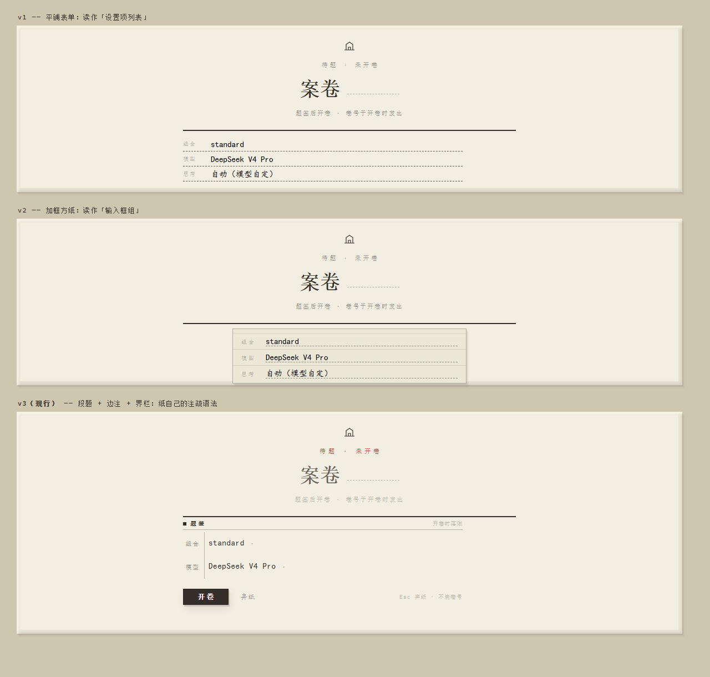
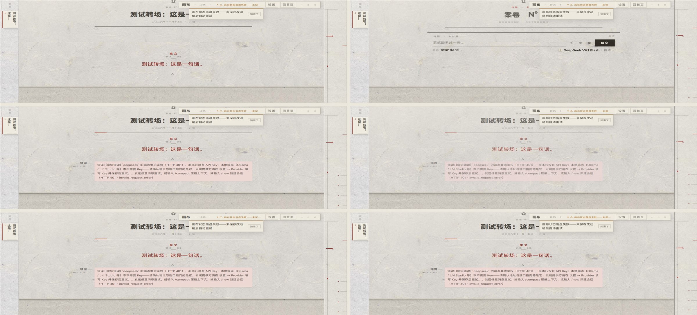
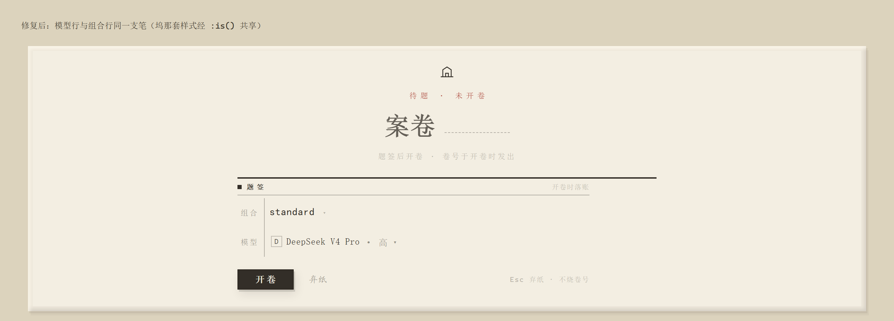
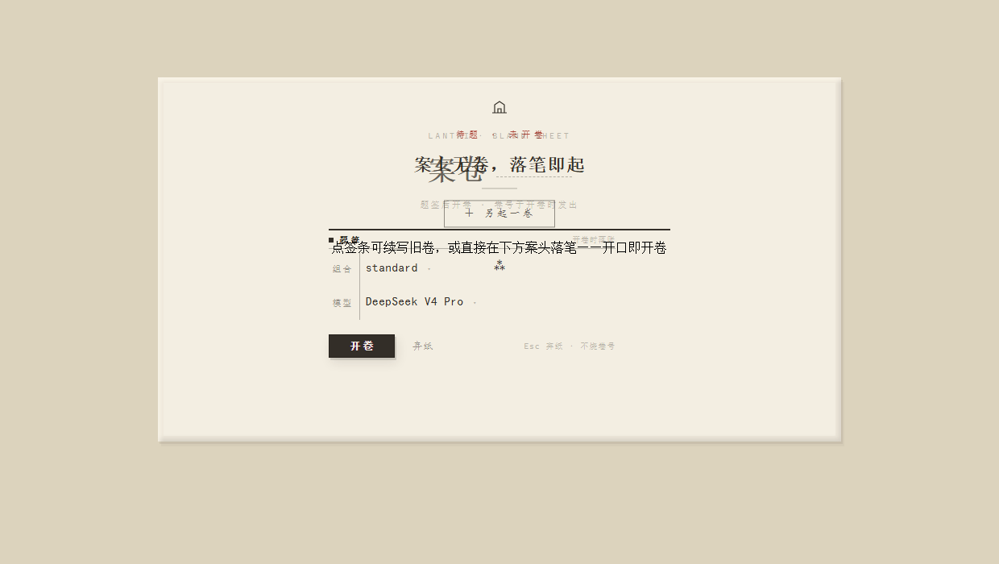
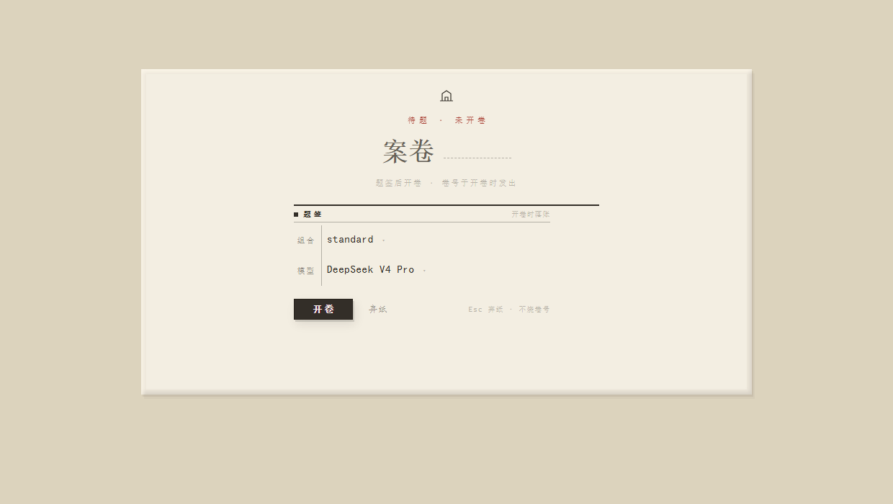

# 新卷出生面（立卷）—— 新建会话的 UX

> 立项：2026-11-14 · **定稿改判 2026-11-15（V2：纸即输入面，「发送即开卷」）**；V1（待题纸 + 开卷按钮）已于 2026-11-14 落地，按 V2 拆除重做。
> 用户原话（意图）：「新建卷的时候不要摊开一个卷，而是先摊开一个初始状态的模块……兰台的区别只是会话全部被铺在了画布上而已。」
> 用户原话（V2 触发）：「点了新建，直接就是一个 input 的 dock，设置、输入、发送消息，UX 很流畅……题签和创作坞之间不要这么割裂。」
> 拍板（2026-11-15）：**题签 + 创作坞合成一张会打字的纸**；**发送即开卷**（不设「开卷」按钮），Esc 弃纸。
> 依赖：`canvas-space-model-notes.md`（总设计 · 原则五：阶段展开只翻译不重写）· `docs/composition/README.md`（卷级组合写路径）· `docs/design/一张纸-Agent软件交互形态设计.md`（无第二层）· `docs/design/lantai-design-spec.md` §15（动效三档）
> 施工纪律：原则一（每步可测切片）· 原则二/三（插件行落位，不动核心）· 原则四（随做随清）

## 0. 一句话

把「新建」从「摊开一整卷成品」改成「**落一张会打字的纸 → 发送 → 纸长成卷**」：出生面是画布上的一卷纸（不是弹窗，也不是全屏向导），**它自己就是输入面**——题签、输入、发送都在纸上；按下发送那一刻发号，纸长成正常的卷，正常的创作坞才冒出来。

**V2 相对 V1 只改了一条判据，但它改的是整条流程的形状**：

| | V1（已落地，拆除中） | V2（本定稿） |
|---|---|---|
| 出生面 | 卷首 + 题签（组合/模型/思考）+「开卷」按钮 | 卷首 + **输入面 + 题签行 + 工具行**（引/夹/案/回取） |
| 坞 | 摊开期间**不出**输入条与设置行 | **整只不渲染**（纸替它） |
| 变成卷 | 点「开卷」→ 发号 | **按发送** → 发号 + 把这句话发出去 |
| 交互次数 | 新建 → 开卷 → 打字 → 发送（4） | 新建 → 打字 → 发送（3，且焦点在输入框） |
| 同屏设置入口 | 纸上一套 + 「案」抽屉里一套 | 只有纸上一套 |

## 1. 现状病灶（全部带代码位置）

| # | 病灶 | 证据 |
|---|---|---|
| 1 | **没有出生瞬间**：点「＋」的那一刻卷已经是成品（发号 → 工厂 → 摊开 → 聚焦飞行） | `canvas-nav/SessionSidebar.tsx` 的 `onNew` → `core.createNewSession()`；空画布 CTA 同路径（`paper-shell/PaperPanel.tsx` 空态按钮） |
| 2 | **出生设置只对程序入口开放**：`createNewSession(ctx, {presetId})` 已能做到「出生即按组合装配」，但 UI 包装器不传 | `app/chat/session-crud.ts` 的 `CreateSessionOptions` vs `app/chat/chat-core.ts` 的 `createNewSession()`（无参转发） |
| 3 | **用户能拨组合的地方全在卷已存在之后**，而组合是**不可逆**的（跑过一轮即锁） | 卷首芯片 `core.selectSessionPreset`（空白闸）、创作坞抽屉里的组合芯片——都要求卷先存在 |
| 4 | **「造模式」是补丁**：因为没有出生面，只能「起一卷 creator + 把开场白预填进输入框、不自动发送」 | `chat-core.createCreatorSession()` + `session-composition.CREATOR_OPENING_PROMPT` |
| 5 | **模型/思考档出生即生效但被埋着**：新卷用「最近使用的 provider+model」，坞里改模型写的是**活跃卷**的会话覆盖 | `state/compose-store.ts` 的 `resolveNewSessionDefault()` / `setModel(sessionId)` |

**结论（定位）**：创作坞管**输入**，却代管了**本卷身份**。身份应在出生那一刻登记；坞负责卷成立之后的**热切换**。两者不冲突，只是位置放错了。

## 2. 设计原则（均由既有宪法推出，不是新发明）

1. **出生面是纸，不是层**——「整个窗口是一张纸、没有第二层」是纸壳地基。故出生面 = 画布上的一卷纸，不引入模态框/全屏引导。
2. **待题是可见的一等状态**，不是「看起来正常、其实没设置过」的空卷——否则又退化成今天的形态。
3. **题签只收「不可晚定」的东西**——组合是字节契约（模型看到的工具与提示面），跑过一轮即锁 ⇒ 必须在出生时定；模型/思考档可晚定 ⇒ 这里只是**出生默认**，不制造门槛。
4. **题完即化卷**（2026-11-14 拍板）：待题纸是**瞬态**，不占画布、不落盘、不进侧栏；开卷后画布上只有正常的卷。
5. **零新真源**：待题期间的三笔不落任何持久状态；开卷时全部写到既有写路径上（卷级组合登记 / 会话覆盖表）。不新造「暂存设置」这一层。
6. **（V2）出生面 = 输入面**：纸不只承载题签，它**就是**这张卷还没成立时的创作坞。「坞管输入」这条既有分工没有变，只是把它的**出生形态**从「一个浮在视口底的匣」抬成「画布上这一张纸」。⇒ 无主态不再是「坞的无主态」，而是「纸的常态」。
7. **（V2）一次动作一个语义**：「开卷」不是动作，是**发送的副产物**。为保证这条，纸面上**不得出现第二个主动作**——没有「开卷」按钮，Antes 的仪式由「纸长成卷」那一拍承担。
8. **（V2）不复制输入面**：纸上的输入面与坞**共用同一份实现**（同一个组件、同一个 input store 作单一真源）。禁在纸上另写一份 textarea/附件/斜杠/回取——那是把「一套设置摆两处」换成「一套输入摆两处」，负债更重。

## 3. 形态

### 3.1 三段（V2）

```
① 落纸   点「＋」（或空画布 CTA） → 画布落点出现一张**会打字的纸**，焦点已在纸的输入面
          卷首已具形（玉徽 / 眉行「待题」/ 题字「案卷 __」）；天头之下 = 输入面 + 题签行 + 工具行
          创作坞**整只不渲染**（纸替它）
② 题签   纸上一整行三件：组合（默认=全局默认）· 模型（默认=新卷出生默认）· 思考档（随模型）
          三件都是 compact 同源控件；纸上**没有第二个主动作**
③ 发送   按发送 = 唯一把纸变成卷的动作：
          发号 → 按题签登记组合 → 落位到纸的锚点 → 把这句发出去 → 纸长成卷 → 坞冒出来
          （动效见 §3.6；Esc 仍是弃纸，不烧号）
```

**判据一句话**：没按下发送 = 这张纸**还不存在**（不占卷号、不落盘、侧栏看不见）。

**为什么砍掉「开卷」按钮**：开卷的真实含义就是「我说了第一句话」。仓库里这条判据早有先例——
无主态坞的「开口即开卷」（`ComposerDock` 的 `onSend`：无活跃卷 → 先建卷再把这句话发出去），
而「空白卷跑第一轮之前仍可拨组合」也已由 `isSessionBlank` 的空白闸兜住。⇒ 题签的「不可晚定」
不需要靠一个按钮来保护，**第一次发送就是那道闸**。

### 3.2 视觉（遵 `FOLIO_TOKENS` 高度契约与设计规范 §10/§11）

**一句话：待题纸 = 卷首照常 + 版心上贴一段注疏。** 但不是「空白卷换个字」——那正是第一版被判"粗糙"的原因。

走过的三版（留作判据，勿重犯）：

| 版 | 做法 | 判词 |
|---|---|---|
| v1 | 三行平铺 + 每行下划线 | 读作**设置项列表**，与纸的语言无关（"太粗糙"） |
| v2 | 加外框 + 落影的「题签方纸」 | 读作**输入框组**——框一上就把纸变成卡片（§11 致死动作①「万物皆框」），更糟 |
| **v3（现行）** | **段题 + 边注 + 界栏 + 正文**（古籍注疏三段式） | 纸自己的语法：段题给归属、界栏分边正文、边注是注不是标签 |



v3 的六条：

1. **段题**：方墨锚点 + 字距小字「题签」，右端一枚注记「开卷时落账」（§11 完工动作③）。没有它，下面两行只是"飘在纸上的表单"。
2. **边注**：两字小字、右齐贴界栏，与文类签（`.pp-kind`）同族。*竖排试过并放弃*：CJK 字体的垂直步进是 1.9em，两个字被撑成一行半、与界栏打架；不值得为三行题签去钉 vmtx。
3. **界栏**：边注与正文之间一条极淡竖线（`--rule-soft`）；**hover 那一段转朱砂**（笔尖点到哪一段，哪一段说话——瞬时态不占常驻红名额）。
4. **玉徽照常实印**：卷首本身是成立的，待题靠**眉行 + 卷号空位**说。给玉徽套框表示"待钤"反而把最漂亮的一笔弄脏（v2 实测）。
5. **卷号是填空题**：题字作「案卷 ____」，虚位一条待填的线（§11 虚线 = 占位）。
6. **开卷 = 卷上唯一主动作**（V1）→ **V2：纸上的唯一主动作 = 发送**（拟文印那枚，与坞同一枚）。
   纸面**不再有第二个主动作**（「开卷」按钮整颗删除，见 §7「不做什么」）。弃纸仍是**无框文字**——
   不是按钮。`--shadow-anchor`（墨底实心方章 / §10 法则 1）随「开卷」那颗一起退役，不再有第二个章。

版式纪律：天头高度仍由 `measureFolioHeadHeight` 测出；天头以下**整块纸栈走流式**（全片唯一的绝对定位是纸栈本身）——v1 按「绝对定位 + 手算每段 top」排，卷首一改高就压线。


### 3.6.0 真机复修（2026-11-15 夜，用户报「题签到真实卷没有好的动画过渡」）

**病灶不是审美，是四条机制性疾病**——全部有真机定帧读数（CDP 台架：触发后暂停全部动画、
逐帧设 `currentTime` 截图，脚本 = `scripts/motion-filmstrip.cjs`，方法见本节末）：

| # | 病灶 | 证据 | 修法 |
|---|---|---|---|
| ① | **化卷淡出从未播过**：`animation: pp-draft-morph var(--m-sheet) var(--m-ease-io) forwards` 是**非法简写**（`--m-sheet` 自带一条 bezier，叠第二段 = 解析失败 ⇒ 声明级联丢弃） | 纸的 `getAnimations()` 里只有一条**匿名** box-shadow 过渡（样式的，不是 keyframes 的）；`opacity` 全程 1.00 直到 260ms 当帧消失 | 全仓 10 处同类（`paper-base` 6 / `folio` 2 / `draft-sheet` 2）改 longhand `animation-timing-function:`；新增 `motion-contract` 守卫「双曲线简写不得回潮」 |
| ② | **交接窗里两片半透明的纸叠着**：卷的 `.pp-spread`（纸淡入）与纸的淡出**同时起手** | 0/65/130ms 三帧：标题「测试转场」与「案卷 Nº」双重曝光、两道规线 | 纸化成的卷走 `pp-rise`（**只落墨、不淡纸**），墨再**让一拍**（0.1s 错峰）等纸先撤字 |
| ③ | **不是同一张纸**：纸用的是流区默认纸色（不取 `--sheet-j`），卷用的是卷 id 哈希出的那套水洗 | 交接期的纸明显比卷浅一档；纸一撤「桌面」就换色 | 纸吃**同一套**纸性三参（`sheet.ts`），交接期种子换成新卷 id（`draftSheetSeed`） |
| ④ | **纸与卷不是同一个盒**：卷落进首块后盒高 552，纸的实测高只有 490 ⇒ 交接那一帧纸的上缘跳 62px | 定帧：sheet `[35,490]` / region `[-28,552]`（同一帧） | 交接期盒由**卷单方面**决定（`morph.box`，卷侧渲染期回填），纸不再自己长 |

还有两条只在真机成立、不修就是「啪一下」的观感问题：

- **天头改口**（「待题」→「已交卷」）在 260ms 的窗里等于**一个字被换掉**——现在**不改口**，
  纸到淡完为止都说「待题 · 未开卷」：它表达的是「这张纸从没变过身份，只是成了卷」。
- **输入面当帧撤**会在发送那一瞬让下半张纸空一块（纸还整张在那儿）——现在它**跟着纸一起退**
  （`.pp-draft-morph`，退场期 `pointer-events: none`），不再凭空消失。

**编排（2026-11-16 改判后的现行口径：「纸不动，字换页」）**——上一版是「纸身与字同窗匀速淡出」，
用户的判语是「做了个渐隐渐现算什么动效」。逐帧读数的病灶：纸淡到 0.61 时卷的字已经在落，
而卷被纸压着看不见；等纸让开，墨已经落了七八成 ⇒ 屏上真正发生的是**两张不同版式的图在互相溶解**。

1. **纸身当帧让位**（0ms）：`background-image: none` + 透明底 + 无影，由底下那张**同种子、同盒、
   同纸性三参**的卷接手——纸纹与纸缘在整个窗里**一帧都不动**。这是「纸没动」的实现，也是
   墨终于看得见的原因。
2. **纸上的字退场**（0–160ms，`--m-ink`）：天头四行**升到卷首将落的位置**再退（位移量 =
   `--draft-rise`，由组件按「卷高 − 纸高」算，禁写死）；天头之下那条输入面只上移 8px 淡出。
3. **卷上的字落下**（40ms / 80ms 起，`pp-drop-in` 18px）：卷先落、正文后落，一页字自上而下现出。
4. **坞从屏幕下缘之外升上来**（`pp-composer-rise`，`--m-sheet` / io）：题签期那条输入面在纸上、
   坞在屏底，两者差 475px；坞若在终点直接出现，中间没有任何一帧交代去向 ⇒ 读作跳变。

**为什么天头要「升到卷首的位置」而不是原地淡出**：卷落进首块后比纸高 63px（两件盒底相同），
卷首因此比纸的天头高 62px。原地退 = 旧字消失、新字在**另一个高度**出现，眼睛读到的是「题签跳了
一格」（上一版实测的 62px 瞬跳正是同一笔账）。升过去再退 ⇒ **原位交接**，两页字在同一个字位换手。

**禁**：宽度过渡 / `transform: scale`（纸纹与天头一起拉变形）· **纸身淡出**（会让「同一张纸」
失效，且必然盖住底下的墨）· 改口 · 输入面当帧撤。纸律（`motion-contract` 钉着）：纸体基座与
化卷规则本体都不声明 `transform/translate/width/scale`；纸上的字走**独立 `translate` 属性**，
绝不写 `transform`（块定位用内联 transform，任何一帧声明都会把块钉到左上角）。



**台架方法**（可复算，脚本已收进仓库）：`node scripts/motion-filmstrip.cjs --times 0,60,120,180,240`
—— 它自己导航进画布（默认 prep：点「＋」落纸、写一句；默认 trigger：点「拟文」），随后把
`document.getAnimations()` 全部暂停、逐帧设 `currentTime` 截图，并把**同帧读数**（纸/卷的盒、
不透明度、卷首文案、块数）一起打出来，截图与读数因此可对拍。

三个要点（都踩过）：① 必须**冻住 `setTimeout(>=150ms)`**（`--keep-timers` 可关）——store 的撤纸
定时器会把纸提前拆掉，读数就全是 null；② 必须**先重新导航**——拿上一轮遗留的页面状态去跑 prep，
会读到「纸已经开过」的现场；③ 无头浏览器的 profile 会烂（实测 `ERR_CACHE_READ_FAILURE` 连片、
整页卡在启动封面），症状是「脚本跑得通但 prep 报 no textarea」——换 `--user-data-dir` 即可。

### 3.6.1 落地口径（2026-11-15，与 §3.6 的草案不同之处）

§3.6 的草案写的是「坞先落成纸的**剪影** → 发送后纸从剪影长成整卷」。施工后改成下面这套，
理由都记在这里（别照草案回去改）：

| 草案 | 落地 | 为什么改 |
|---|---|---|
| 纸「长」成卷（宽度/形态变化） | 纸与卷**本来就同宽同锚点**（都按 `STREAM_REGION.width` 落位）⇒ **不做任何尺寸变化** | 宽度过渡/缩放会把纸纹与天头文字一起拉变形；而且「化卷」的语义是**纸落到桌上**，不是纸被拉伸 |
| 坞落成剪影 | **坞不参与**这一拍 | 纸在场时坞整只不渲染（V2-P1）；让它先出现再变形 = 多一帧两层叠着 |
| 交叉淡入 | **纸就地淡出 + 卷淡入**，两件同档同曲线 | 这不是交叉淡入（不是「甲淡乙亮」的重叠），而是**同一个位置**上纸退、卷起；中间没有两件都半透明的帧——纸在交接态就把输入面撤了，读到的是「这张纸正在变成卷」 |

交接期的三件事（`DRAFT_MORPH_MS` = `--m-sheet`，窗满 store 自己撤纸）：

1. **`open` 已 false** ⇒ 坞在下一帧就可以出现（它属于新卷）；
2. **`morph` 在场** ⇒ 纸张力上仍渲染；**天头不改口**（§3.6.0：改口 = 260ms 里换字）；
3. **输入面跟着纸一起退**（§3.6.0：当帧撤 = 下半张纸空一块），退场期不接点击、不吃焦点。

> ⚠ 本节三条原写「纸就地淡出 + 卷淡入…输入面撤掉」，已被 §3.6.0 的真机定帧复修推翻：
> 卷**不淡入**（不重播纸淡入）、输入面**不当帧撤**、天头**不改口**。
> ⚠ 表里第三行「纸就地淡出」也已被 **2026-11-16 改判**推翻：纸**不再淡出**（当帧让位给底下那张
> 同纹同盒的纸），走的是纸上的字。现状以 §3.6.0 为准。

动效敏感（`prefers-reduced-motion`）= **当帧撤纸**（不升级成一座停在那儿的纸）。
纸律：纸体基座与化卷规则本体都不许声明 `transform/translate/width/scale`；纸上的字走独立
`translate` 属性（`tests/motion-contract.test.ts` 的正反两向断言钉住）。

### 3.3 三笔题签落到哪（交接表）

| 题签项 | 待题期间 | 发送（= 开卷）时写哪 | 不可用原因面 |
|---|---|---|---|
| 组合 | 待题纸本地态（插件域） | `createNewSession(ctx, { presetId })` → 卷级登记（**既有路径**） | `sessionSelectionError`（严一档） |
| 模型 | 同上 | `compose.setModel(新卷号, provider, model)`（**既有路径**） | provider 目录 |
| 思考档 | 同上 | `compose.setThinking(新卷号, 档位)`（**既有路径**） | per-model 档位表 |

- **默认可直接发送**：三件都有默认值（全局默认组合 / 新卷出生默认模型 / 该模型档位），用户不碰也能直接打字发送。
- **写路径不新开**：不引入「出生参数」这第二个真源——题签的产物落在卷级登记与会话覆盖上，与「空白卷上拨」完全同尺。

### 3.4 与既有入口的关系

| 入口 | 今天 | 本设计 |
|---|---|---|
| 侧栏「＋」 | 直接建卷 | **改为落待题纸** ✅ |
| 空画布 CTA「另起一卷」 | 直接建卷 | **改为落待题纸** ✅ |
| 创作坞「✎ 造模式」 | 起 creator + 预填开场白 | **改为落待题纸并预选 creator** ✅；开场白**预填进纸自己的输入面**（V2：纸上就有输入面，不再需要"开卷后"这一步） |
| 立枝（从消息另起一枝） | 复制历史建枝 | **不动**——枝不是"新卷"，没有题签语义 |
| 程序入口 `createSessionWithPreset` | 按组合起卷 | **不动**——无 UI，已是"出生即定组合"的正确形态 |

出生面是**默认入口**，不是唯一入口；绕过它建出来的卷仍是合法卷（空卷、恢复卷、枝）。

### 3.5 键盘与中断

- **Esc = 弃纸**：不烧号、不落盘、画布无残留。
- **待题纸唯一**：同一时刻最多一张；再点「＋」= 把当前这张重新定位，不叠加。
- **切工作区 / 关画布 = 弃纸**（瞬态）。
- 开卷失败（组合不可解析 / 无工作区）= 纸留在原地 + 具名原因（错误不静默），不退回"建了半截的卷"。
  （V2：失败发生在**按发送**那一刻；失败 = 纸还在、输入内容还在、原因写在纸脚——不许把用户刚打的字弄丢。）

### 3.6 化卷那一拍（V2 动效）

**不是交叉淡入。**「坞淡出 + 纸淡入」会有一帧两件都半透明，读起来是「换了个东西」，反而强化割裂。
要做的是**同一个物体长起来**：坞先落成纸的**剪影**（纸色、天头已具形、天头以下空着），发送后
**纸从剪影长成整张卷**（天头以下展开、正文区撑开），坞壳在这一拍里消失。

复用的是**已有的一拍**：`paper-shell/region-motion.ts` 的落纸窗（`.pp-spread` 纸淡入，满一窗才摘类）。
⇒ 「转换」不是新动效，是把既有那一拍**提前到发送那一刻**。

四条不变量（施工时逐条核，漂一条即返工）：

1. **只动 transform / opacity**（纸律，`tokens.css` §15 运动法则）——不写逐帧 JS 布局动画。
2. **一个动效主体**：纸长起来 + 坞壳淡出是一件事。坞槽高度变化**用 transform 缩放**，
   不用 height 过渡——否则把让位带 `--composer-band` 的消费面（名册见 `composer-band.ts`）全带抖。
3. **时长只有一档**：`--m-sheet`（260ms，与 `REGION_MOTION_MS` 同一把尺子）。
   要更长就升 `--m-scene` 并在 §15 登记理由，**禁散写**（`tests/motion-contract.test.ts` 拦）。
4. **动效不阻塞交互**：发送后立刻进「落墨中」态，用户可继续打字（插入回合），不等动画。

## 4. 边界：待题纸不是「空卷」

三种态必须分清楚，施工时最容易混：

| 态 | 判据 | 占卷号 | 落盘 | 侧栏可见 |
|---|---|---|---|---|
| **待题纸**（本设计新增） | 插件域本地态 | 否 | 否 | 否 |
| **空白卷**（既有 `isSessionBlank`） | 已建卷、0 消息 | 是 | 是 | 是 |
| **跑过一轮** | 有消息 | 是 | 是 | 是 |

⇒ 本设计**不新增第四种持久状态**：它把「空白卷」的窗口**前移**（以前先得到空白卷再拨组合，现在先题签再得到卷）。空白卷本身仍然存在——程序入口、立枝、恢复、以及"开卷后不发言"都会产生它。

## 5. 施工切分（V1 · 2026-11-14，**已被 §8 的 V2 取代**）

> ⚠ 本节的 P0-P4 是 V1 的切分与落地账，**留作判据不作现状**：V2（§8）换的是「纸里有什么」与
> 「谁来开卷」，其中 P1「开卷按钮」与 P0「坞不出输入条」两条已被推翻。现状口径一律读 §8。

> **落地账（2026-11-14）**：
> - **P0 待题纸** ✅ —— `state/draft-sheet-store.ts`（瞬态单例，三处宿主桥同步）+ `paper-shell/DraftSheet.tsx`
>   （纸在 `.pp-world` 里，与流区同一坐标语言）+ `draft-sheet.ts`（纯函数面：落位/收拢高/状态词）。
> - **P1 题签 + 开卷** ✅ —— 三笔题签 + `core.createSession({presetId})`（复用 S6 P4 程序入口：
>   发号后、工厂前登记卷级组合）+ `core.placeRegion`（开卷不跳位）+ 全默认零覆盖。
> - **P2 入口收编** ✅ —— 侧栏「＋」/ 空画布 CTA / 造模式三处改道；造模式改为「预选 creator 的
>   待题纸 + 开卷后填开场白（仍不自动发送）」。
> - **P3 视觉与动效** ✅ —— 三版迭代后定稿（v1 表单 / v2 卡片 / **v3 注疏三段式**，见 §3.2）；
>   落纸入场沿用 `--m-sheet` 一档。仍**待真机走查**再钉值。
> - **返修（2026-11-14 真机两报）** ✅ —— 模型选择框去塑料皮（坞那套样式经 `:is()` 两宿主共用）·
>   开卷落位与「出生即展开」两处**可选链静默失效**补齐（`ChatCore.placeRegion` / `requestFocus`）。
>   详见 §6.5；三颗钉子 = chat-core-request-focus / chat-core-place-region / paper-draft-placement-split。
> - **门禁**：`tsc` ✅ · `vitest` 全量 ✅ · `biome ci` 0 错 ✅ · `build`（含内置插件产物）✅ · `doc-check` ✅

| 切片 | 内容 | 可测断言 |
|---|---|---|
| **P0 待题纸** | 新增出生面组件（`paper-shell` 插件域）+ 落点；「＋」/CTA 改道；Esc 弃纸 | 点「＋」后 `sess.sessions.length` **不变**；Esc 后画布无残留、无落盘 |
| **P1 题签 + 开卷** | 题签行三件 + 开卷命令：起卷（带 presetId）→ 写会话覆盖 → 落位 | 开卷后 `sessionCompositionInfo` 读到 `source:'session'`；`isSessionBlank` 为真；坞恢复输入条 |
| **P2 入口收编** | 造模式改道（预选 creator）；空态整块让位 | 造模式在开卷前不建卷；开卷后输入框有开场白 |
| **P3 视觉与动效** | 落纸入场 / 化卷过渡 / 版心对齐 | 视觉钉值进既有 `tests/paper-*` 与 `motion-contract` |
| **P4 文档涟漪** | `docs/composition/README.md` 补一句（出生面是组合的**同一把尺子**，不是第二条写路径）、HISTORY、索引 | `npm run doc-check` 绿 |

## 6. 门禁

- `cd src-ui && npm run build`（含内置插件产物构建）· `npx vitest run` · `npx biome ci .`（0/0）
- 本批预计**不碰** `agent/**` 与 `composition/**` ⇒ 不需要 `verify:convergence`；若 P2 牵到组合装配则必须补跑
- `npm run doc-sync` + `npm run doc-check`

## 6.5 真机返修两笔（2026-11-14，用户报「模型选择框丑」+「开卷后定位全错」）

**① 模型选择框「非常丑」——根因是样式住在坞作用域里。**
ModelSelector 的触发器/弹层规则全写在 `.pp-composer` 作用域下（`paper-toc.css` 22 条），
纸上没有那个祖先 ⇒ 落回浏览器默认 button 皮（灰底圆角边框 + 系统字体）。
修法不是复制一份（会立刻漂），而是把坞那套改成 **`:is(.pp-composer, .pp-draft-row)` 两宿主共用**；
纸片只留三处差异：网格列位 / 手写笔族（楷体 + `--fs-lead`）/ 弹层朝向（向下开、贴本行）。
另有一条纸上特有：坞内触发器是**定宽 pill**（`width:100%`），纸上是**一行值**——
不覆盖就会出现「厂商章在最左、模型名飘中间、箭头在最右」的散架感（真机判丑的直接原因）。



**② 开卷后「很多东西定位错」——两个可选链把两件事静默吞了。**

| 症状 | 根因 | 修法 |
|---|---|---|
| 匣脚引线整层不画 / 坞对着别处 / 目次带不指向新卷 | `core.requestFocus?.(sid)`，而 **ChatCore 从来没有这个能力位** ⇒ 可选链把「标活跃流区 + 请求飞行」整段吞掉 | 补真方法 `ChatCore.requestFocus`：`setActiveRegion` + `useCanvasViewStore.requestFocus` |
| 纸在这儿、呼吸灯与引线在那儿（卷落在别处） | `placeRegion` 走 `activeSpace()?.place(...)` ——**空间服务不在场时静默 no-op**，随后落位 effect 的 `nearestFreeRegion` 接管；空画布上两个算法同值（测不出来），用户平移过画布就分家 | `placeRegion` 直写 `canvas-store`（落位是画布状态的唯一真源写入；space.place 只是同一次写入的插件侧转发口） |

两条钉子：`tests/chat-core-request-focus.test.ts`（活跃流区 + 定位请求）与
`tests/chat-core-place-region.test.ts`（**无 space 服务时仍必须落位**——正是原来漏掉的情形）。
第三颗：`tests/paper-draft-placement-split.test.ts`（开纸后平移视口 ⇒ 卷仍落在纸的锚点，
把「两个算法恰好同值」这种假绿堵死）。

## 6.6 空画布重叠（2026-11-15 用户报「点新开卷之后文字会和题签重叠」）

**根因：空态与案头形态读的是同一条判据 `sessions.length === 0`，而待题纸不建卷。**
待题纸的全部意义就是「还没开卷 = 还没发号」，于是 sessions 仍是 0 ⇒ 两样东西都以为
还是空案头，与纸同屏叠着画：

| 同屏物 | 内容 | 后果 |
|---|---|---|
| 空态块 `.pp-empty`（z2，压在 world 之上） | LANTAI · BLANK SHEET /「案上无卷，落笔即起」/ CTA / 引导句 / 花押三星 | 直接压在题签上（用户报的那一幕） |
| 案头形态 `pp-at-desk` + `DeskShelf` | 坞退匣直书、坞下挂「续 · 卷名」签条架 | 同样的重叠 |

**修法：把「纸在场」并进这两条判据**（一处判据两处消费，不新增状态）：
空态 `sessions.length === 0 && !draftOpen`；案头态 `desk = sessions.length === 0 && !draftOpen`。
⚠ `draftOpen` 必须**订阅**（`useDraftSheetStore((s) => s.open)`）——用 `getState()`
开纸那一刻不重渲，坞会停在案头形态。




钉子：`tests/paper-draft-empty-overlap.test.tsx`（空态退场）+ `tests/paper-draft-desk-mode.test.tsx`（案头退场）。

## 6.7 一条新纪律：待题纸不建卷，故**所有「零卷」判据都要排除它**

这是本设计最容易反复踩的一类坑——任何以 `sessions.length === 0` / `activeSessionKey === null` /
`isSessionBlank` 为判据的界面，都要问一句「纸在场时这条判据还成立吗」：

| 判据 | 纸在场时本应 | 已处理 |
|---|---|---|
| 空态块 `.pp-empty` | 退场（纸就是出生面） | ✅ `&& !draftOpen` |
| 案头形态 `pp-at-desk` + 签条架 | 退场（坞照常、不出架） | ✅ `&& !draftOpen` |
| 见底呼吸线 / 落笔点 | 不受影响（读的是运行态，不是卷数） | — 无需改 |
| 匣脚引线 | 不受影响（`activeSessionKey === null` 时不画，本来就不该画） | — 无需改 |

**判据实现纪律**：`draftOpen` 必须**订阅**（`useDraftSheetStore((s) => s.open)`）。
用 `getState()` 读一次是不对的——开纸那一刻不重渲，界面停在旧形态（案头不会退）。

## 6.8 无主态逐件表（V2 的收敛点）

用户 2026-11-15 的判断：「这些问题会收敛为『无主态的创作坞的 UX 应该是什么样的』」——对。V2 把这张表
当成**唯一收敛点**：纸在场时每一件长在哪、发给谁，下面逐件定死；表外没有别的态。

| 件 | 纸在场（无主态） | 发送后 |
|---|---|---|
| 天头（玉徽/眉行/题字） | 眉行「待题 · 未开卷」+ 题字「案卷 __」 | 卷号发出，眉行变卷次 |
| 输入面 | 在纸的正文区，**唯一真源仍是 input store** | 同一位置，成为正常坞的输入行 |
| 题签行 | 纸上一整行：组合芯片 + 模型 + 思考档 | 卷首芯片接管（空白卷仍可拨） |
| 引 / 夹 / 案 / 回取 | 纸上工具行，与坞同一批组件 | 不变，归属从「纸」变「卷」 |
| 斜杠 / 技能面板 | 纸上向上开（贴本行） | 不变 |
| 请求态（思考中 / 停止 / 权限卡 / 目标条） | **画在纸的正文区**，天头保持静态 | 不变 |
| Esc | 弃纸（不烧号、不落盘） | —— |
| 锚点 | `draftPlacement`（视口中心最近空位）——**原样保留**；**落纸与聚焦同拍**（§6.9） | 卷落在纸的锚点（`placeRegion` 照旧） |
| 坞壳 | **整只不渲染**（纸替它） | 冒出来 |

**这一条顺带解掉了 V1 的一个隐患**：锚点不必改成「发送时才算」——`draftPlacement` 整条留用，
真正要重写的是「谁渲染坞」：纸在场时槽位让给纸，坞只是纸的替身。

## 6.9 落纸即聚焦（2026-11-16，用户报「点新建视角不跟过去」）

用户原话：「点击新建之后视角不自动聚焦……要专门去找题签创建到了画布的什么位置」。

**根因不在聚焦代码，在「落位」与「聚焦」被拆成了两件事**：落点 = **视口中心最近的空位**
（`draftPlacement`），它是「离中心最近**且不与任何卷重叠**」的位——画布上卷一多，这个位就在
视口之外。而摊开纸这一步只写了 anchor，**没有任何一个动作把镜头带过去**（`requestFocus` 那条通道
只认卷号，纸还不是卷）。于是纸上屏外、画面纹丝不动，用户只能自己去满画布找。

**定案：落位与聚焦是同一个动作。**

| 件 | 口径 |
|---|---|
| 聚焦点 | `draftFocusPoint(anchor)` = **纸盒竖直中线**（世界坐标）。不取锚点：锚点不是纸的几何中心——盒底 = 锚点 + 底距、盒高 = 零块卷最小盒高，取锚点会把纸整块推到正中以下（实测 800 高视口里纸顶被切掉 90px） |
| 通道 | 槽主人的 `PaperDockContext.glideTo`（待题纸**不是卷、没有 sessionId**，`requestFocus` 对它不成立）；**能力位缺席 = 不飞**，纸照常落位 |
| 时机 | 摊开纸的那一拍（`openSheet` → 落位 effect）；代数 `landNonce` 记「第几张纸」——再点「＋」= 把这张纸重新定位，几何可能一字未变，仍要回镜头。**只在纸整块不在视口里时才动镜头**（`draftBoxInSight`：视角是用户的，自动动作只在「你按了＋却看不见」这一种情形里才配动它——同 2026-09-01 视角抢夺修复的口径） |
| 开卷时 | `openDraftVolume` 只**标活跃**，不再无条件请求飞行：落纸那一拍镜头已经在纸上了，而卷与纸同锚点同宽，再飞一次只是让视线在化卷那一拍自己动一下。判据 `volumeInSight`（卷锚投到屏幕后是否落在画布矩形内）；**不在眼前才飞** —— 底线仍是「出生即展开不许看不见」 |

钉子：`tests/paper-draft-landing.test.tsx`（① 单元面：纸落屏外 ⇒ glideTo 收到中线点 / 再点「＋」仍回镜头 /
重渲染不重播 / 能力位缺席不炸；② 判据面：`volumeInSight` 三态；③ 端到端：真 PaperPanel + 真 ChatCore，
卷一多 ⇒ 摊开后**纸盒整块落在视口里**，且开卷时在眼前 ⇒ `pendingFocusId` 保持 null、不在眼前 ⇒ 照旧请求）。
变异检验：摘掉 glideTo 那一句 ⇒ ①②③ 共 4 例转红（含端到端那条）。

## 7. 不做什么（说清楚，免得施工时漂）

- **不做全屏 onboarding / 多步向导**：违「没有第二层」。
- **不做待题纸批量摆放**：已拍板「化成卷」，画布上不留空纸。
- **不在待题期落任何持久状态**：零新真源；草稿纸丢了就是丢了。
- **不做"出生后再补设置"的引导气泡**：所有"出生时该定的"都在题签行里，之后归创作坞热切换。
- **（V2）纸面不出现第二个主动作**：没有「开卷」按钮、没有「确认」步骤——发送是唯一出口（§0 拍板）。
- **（V2）不在纸上另写一份输入面**：共用同一份实现与同一个 input store（原则 8）。
- **（V2）不做坞↔纸的交叉淡入**：换形不换物（§3.6）。
- **（V2）纸在场时坞不走"隐藏输入条"的老路**：整只不渲染。V1 的 `hidden={draftOpen}` 那几处判据随本批拆除。

## 8. V2 施工切分（2026-11-15 定稿；一批一 commit）

> 前置：V1 已落地的那套（纸渲染 + 落位 + `createSession({presetId})` + 几何编排）**能留的全留**——
> V2 换的是「纸里有什么」和「谁来开卷」，不是纸本身。真正拆掉的只有「把输入面挡在门外」与「开卷按钮」。

| 批 | 内容 | 可测断言 | 主要落点 |
|---|---|---|---|
| **V2-P1 输入面进纸** | 纸上长出完整输入面（与坞共用同一份实现、同一个 input store）；纸上工具行收编「引/夹/案」；坞在纸在场时**整只不渲染**（拆 `hidden={draftOpen}` 与案头判据里的 `!draftOpen` 双轨） | 开纸后 `sessions.length` 不变、输入框可打字、input store 只有一份真源 | `paper-shell/DraftSheet.tsx` · `compose-dock/*` |
| **V2-P2 发送即开卷** | 发送 = 发号 + 登记组合 + 落位 + 发出这一句；删「开卷」按钮与 `onOpen`；Esc 弃纸保留 | 发送前 = 0 卷；发送后 = 1 卷 + 1 条用户消息 + 卷级组合来源 `session` | `DraftSheet.tsx` · `chat-core.ts` |
| **V2-P3 化卷一拍** | 纸从剪影长成整卷 + 坞壳消失（§3.6 四条不变量） | 动效只动 transform/opacity；时长 = `--m-sheet`；动效期间可继续输入 | `region-motion.ts` · CSS |
| **V2-P4 测试面与文档** | `paper-draft-sheet-behaviour` / `paper-draft-open-geometry` 的「开卷按钮」两条行为退役 ⇒ 同批删；改写为「发送即开卷」「无第二主动作」新例；`docs/composition/README.md` 造模式一行、`docs/plans/README.md` 一行同步 | `vitest` 全绿且**测试 diff 形状 = 整删整增**（禁改造后放回） | 测试 + 两份文档 |

**门禁**：`npm run build` · `npx vitest run` · `npx biome ci .`（0/0）· `npm run doc-check`；
本批不碰 `agent/**` / `composition/**` ⇒ 不需要 `verify:convergence`（若纸改道牵到组合装配则必须补跑）。

> **落地账（2026-11-15，V2-P1/P2/P4 已落地；P3 化卷动效当时「已标记落地」但真机从未播出——见 §3.6.0 复修）**：
> - **P1 输入面进纸** ✅ —— `DraftSheet.tsx` 只画纸（卷首 + 天头下一整块流式栈），天头之下
>   渲染 `overlays` 的新槽 `'draft-sheet'`；`ComposerDock.tsx` 拆成
>   `ComposerDock`（坞壳，纸在场即 return null）+ `ComposerSheet`（纸期，同一份
>   `ComposerSurface` 实现、同一个 input store）。纸期设置行 = 题签（组合 + 模型），
>   无权限段；纸期书眉 = 「待题 · 未开卷」+ 弃纸。V1 的 `hidden={draftOpen}` 双轨已拆。
>   - 纸高改**实测**（ResizeObserver 回写 `top = 锚点 − 实测高`）：V1 的 `DRAFT_BODY_H`
>     是「三行题签」的算术，输入面进纸后必错，同批删除。
>   - 题签三件搬进 `draft-sheet-store`（`picks`）：发送面要读它，留组件态 = 两处真源。
> - **P2 发送即开卷** ✅ —— `ChatCore.sendMessage` 的纸在场分支 → `openDraftVolume`
>   （编排本体在 `session/draft-opening.ts`：存正文 → 起卷 → 还正文 → 落位 → 出生即展开
>   → 题签落会话覆盖）。「开卷」按钮与 `createSession({presetId})` 包装器同批删除。
>   失败 = 纸还在、字还在、原因写纸脚。
> - **P3 化卷一拍** ✅ —— 见 §3.6.1（实现口径与 §3.6 的差别在那里记）：纸**不当帧撤**，
>   进交接态 `morph`（`DRAFT_MORPH_MS` = `--m-sheet` 260ms）——天头改口「已交卷」、
>   输入面整块撤掉、纸就地淡出（**只动 opacity**，不宽度/不缩放）、影从「待题纸」升到
>   成卷档；窗满由 store 自己撤纸，动效敏感 = 当帧撤。新卷的 `.pp-spread` 落纸与它是
>   同一档同曲线 ⇒ 一次动作两头。钉子：`tests/paper-draft-morph.test.tsx`（交接态 /
>   窗满真撤 / 交接期开新纸）+ `tests/motion-contract.test.ts`（窗长镜像 + 纸律）。
> - **P4 测试面与文档** ✅ —— `paper-draft-*` 九件按新判据整删整增（「开卷按钮」两条
>   行为退役）；`docs/composition/README.md` / `docs/plans/README.md` 同步。
> - **门禁**：`tsc` ✅ · `vitest` 4954 passed（唯一红 = `god-file-budget` 的
>   `src-tauri/src/utils/bg_jobs.rs` 1466 行——**不是本批的文件**，见该测试头注）·
>   `biome ci` 0 error ✅ · `build` ✅ · `verify:convergence` 双轨 ✅ · `doc-check` ✅
>
> **落地账·补（2026-11-15 夜，化卷一拍真机复修）** ✅ —— 四条机制病灶 + 两条观感问题全修（§3.6.0）。
> 关键教训：**「已落地」的判据只能是真机帧，不能是测试绿**——上一轮的 `paper-draft-morph` 五条
> 用例全绿，而纸一次都没淡过（用例只查 `data-morph` 属性在不在，不查 `getAnimations()` 有没有那条动画）。
> 本轮补的守卫：`motion-contract` 的「双曲线简写不得回潮」（全仓扫）+ 落墨窗 `pp-rise` 钉值。

